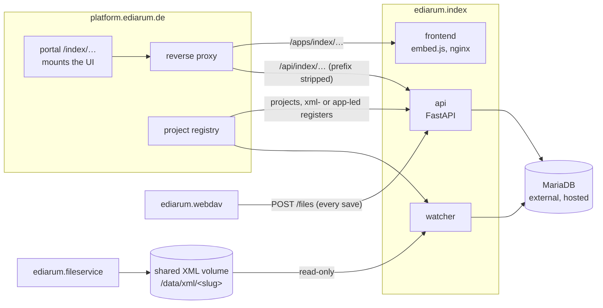

# ediarum.index

The authority registers of the BBAW editions, running as an app of
**ediarum.platform**: **entries** (persons, places, groups, organisations,
works, bible books, glossary entries) per project, stored in MariaDB, browsed
and edited in a Vue UI, ingested from and exported back to the projects' TEI
XML registers.

**Where the registers live depends on the project.** The platform project
registry marks each project `xml`- or `app`-led; the texts are TEI files
either way. For an `xml`-led project the TEI files stay
the ground truth: every save in ediarum.webdav is posted here, and a watcher
ingests the changed registers from the platform's shared XML volume (read-only
— this app never writes the files). For an `app`-led project the entries are
kept here; file notices are acknowledged without queuing and the watcher skips
it. An entry created here without a `source_id` gets one from ediarum.id, so
texts can reference it. Either way
`GET /{project}/export/{entry_type}` rebuilds the register XML.

## How it fits into the platform

- Portal users authenticate with their platform login (the api checks each
  request against the platform's verify endpoint); ediarum/oXygen and scripts
  with an API key.
- The `api` queues the `POST /files` notices; the `watcher` ingests a project
  when its registers on the volume change, and every project on its first
  start.
- `api`, `watcher` and `frontend` come from `docker-compose.yml` (the released
  images: `$CI_REGISTRY_IMAGE:X.Y.Z` and `$CI_REGISTRY_IMAGE/frontend:X.Y.Z`,
  built by CI from a `vX.Y.Z` tag). ediarum.deploy runs the same images; the
  compose file is that setup on its own.

## Where to read on

| If you want to… | Read |
|---|---|
| deploy, update or run it | [Operate](operate/deploy.md) |
| work on the code | [Develop](develop/index.md) |
| know why the data model looks the way it does | [Concepts](concepts/schema.md) |
| understand how a register gets in and out | [Ingest & export](ingest/index.md) |
| look up a route, setting, command or table | [Reference](reference/routes.md) |
| read a module's or function's docstring | [Python API](api/index.md) |
